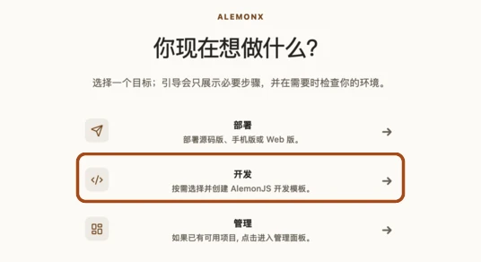
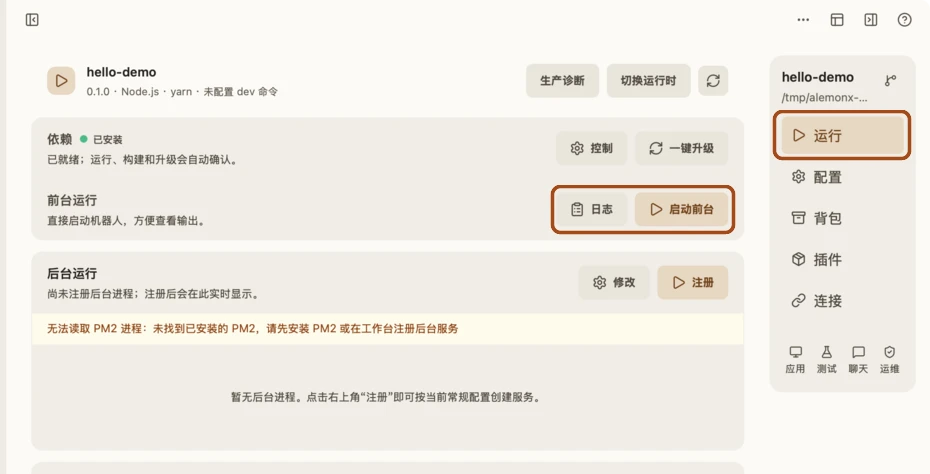

# 快速上手

以 macOS 桌面版为例，点图可放大。

## 1. 打开桌面工作台

按[桌面版安装说明](/docs/alemonx/getting-started/install#桌面版)打开 **ALemonX Desktop**，在首次引导里选择目标。

- 想编写自己的指令，点 **开发**，按引导检查环境、填写项目名称并确认创建。
- 已有本地项目或 Git 仓库，点 **管理**，再选择 **添加本地目录** 或 **从 Git 克隆**。
- 想安装已有的机器人，点 **部署**，按引导选择部署方式。

## 2. 选中项目，启动前台

当机器人出现在左侧列表后，点项目名称，再点右侧 **运行**。检查页首的项目名称和依赖状态。在 **前台运行** 一行点 **启动前台**，按弹窗确认。需要配置平台时，按[连接平台](/docs/alemonjsDocs/getting-started/connect-platform)填写项目对应的配置。

## 3. 检查运行结果

点 **日志** 查看本次输出。已登录平台时，发一条已知指令并确认收到回复。

[创建与导入](/docs/alemonx/use/projects/create-or-import) · [日志与后台运行](/docs/alemonx/use/runtime/run-and-monitor)
