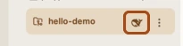
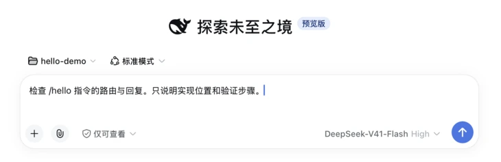

# Agent 任务

首次使用 DSH 时，按界面提示配置 DeepSeek API Key。

## 打开项目工作区

点机器人列表里项目右侧的 **在 DSH 中打开**（鲸鱼图标）。DSH 会显示该项目的工作区。

## 发送任务

在输入框写明要检查的内容。只需分析时，点访问模式选 **仅可查看**，再点 **发送消息**。任务会出现在会话中。

看到 `MISSING_CREDENTIAL` 时，先配置所选模型的 API Key，再重发。
