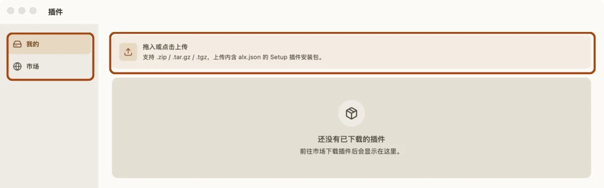

# 安装系统插件

在这里安装扩展 AlemonX 本身的插件，例如本机管理面板。

## 打开插件窗口

点击工作台最左侧工具栏的 **插件** 图标，打开独立窗口。左侧的 **我的** 用于查看和上传插件，**市场** 用于浏览可下载的插件。

1. **从市场下载**：切到 **市场**，找到所需插件，先核对工作台版本和系统架构。
2. **上传本地安装包**：在 **我的** 点击或拖入发布者提供的 `.zip`、`.tar.gz` 或 `.tgz`。安装包应包含 `alx.json`。
3. 回到 **我的** 找到插件，按插件卡片提供的操作启用或打开。需要执行具体任务时，在面板里查看结果和日志。

## 安装与数据目录

工作区中的系统插件目录为 `<workspace>/plugins`，插件持久数据默认位于 `<workspace>/store/<插件 ID>`。排查问题时先确认当前工作区，避免检查另一个工作区的同名插件。

可以使用 `alx plugin list` 查看系统插件列表。更多命令见 [工作台命令行](/docs/alemonx/reference/cli)。

## 遇到问题

- 插件未列出：检查当前工作区、插件目录与 `alx.json`。
- 不支持当前系统：核对发布包的操作系统与处理器架构。
- 面板可打开但动作失败：查看动作日志，核对运行环境与所需授权。

编写自己的系统插件，请进入 [系统插件开发](/docs/alemonx/develop/system-plugins)；开发机器人功能请进入 [编写指令](/docs/alemonjsDocs/getting-started/quick-start)。
