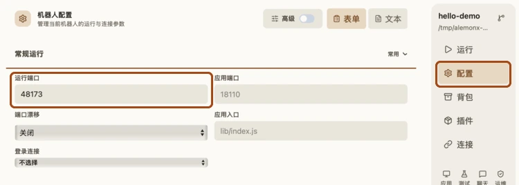
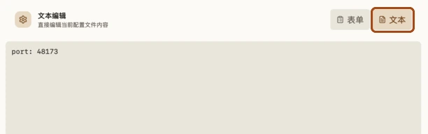

# 机器人配置

## 用表单改参数

选中机器人，点右侧 **配置** → **表单** → **常规运行**。这里能看到运行端口、应用端口、入口文件和登录连接。修改后自动保存。

## 查看 YAML

点 **文本**。在 `alemon.config.yaml` 中可以看到刚才的运行端口对应 `port`。

[运行配置字段](/docs/alemonjsDocs/getting-started/config) · [连接平台](/docs/alemonjsDocs/getting-started/connect-platform)
