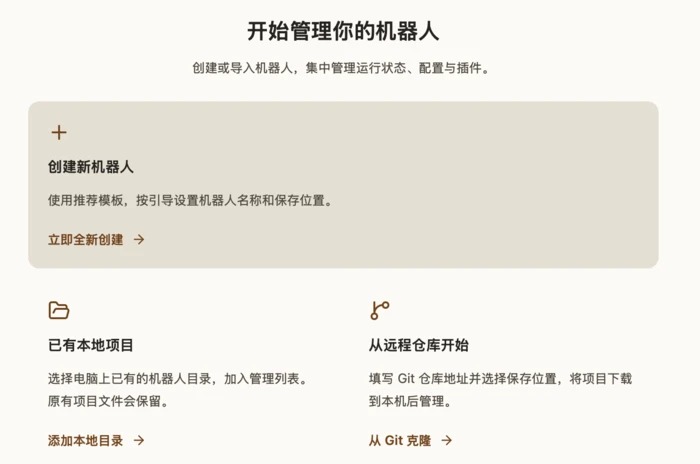
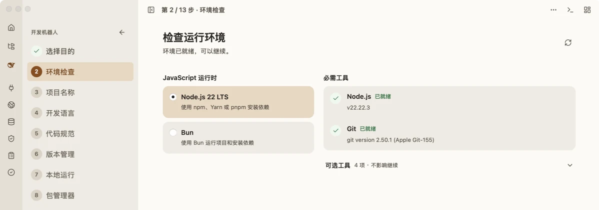

# 创建与导入

## 从已有项目开始

在工作台左侧点击 **主页**。空工作台会显示「开始管理你的机器人」，可以直接选择项目来源。

- **添加本地目录**：选择包含 `package.json` 的项目根目录，点 **添加**。
- **从 Git 克隆**：填写 Git 仓库地址，选择保存位置，再执行克隆。私有仓库需要具备访问权限。
- **立即全新创建**：打开创建引导，按接下来的步骤选择目标。

列表中已有项目时，可用「机器人」标题旁的 **添加本地机器人目录** 和 **从 Git 克隆机器人** 图标继续添加。

## 跟着引导创建开发项目

1. 在引导里选择 **开发**，进入「检查运行环境」。
2. 按项目需要选择 **Node.js 22 LTS** 或 **Bun**。在「必需工具」里确认每项都显示 **已就绪**，然后点 **继续**。

通过环境检查后，填写项目名称和保存位置，按引导选完开发语言、包管理器等选项，点击 **确认创建项目**。

创建或导入成功后，项目会出现在左侧「机器人」列表。点开项目，核对名称和路径，再打开[机器人配置](/docs/alemonx/use/projects/configure)填写项目所需参数。

继续阅读[运行与日志](/docs/alemonx/use/runtime/run-and-monitor)。
