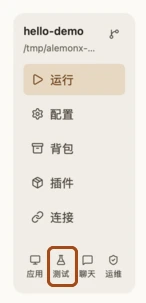
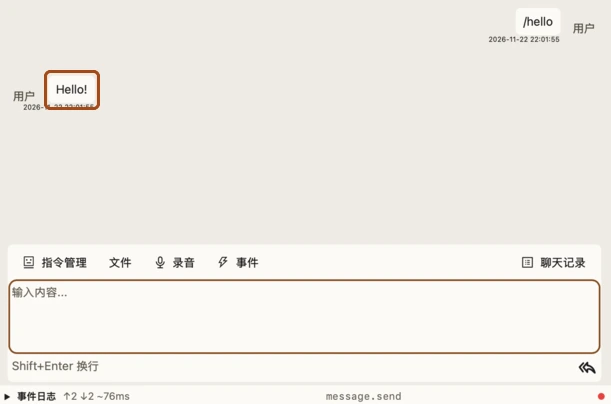

# 本地测试

## 打开测试台

选中机器人，点右侧下方的 **测试**。弹出「配置服务端口」时，填该项目可用的空闲端口，点 **启动测试**。测试台打开后，左下角显示 **已连接**。

## 验证回复

点聊天输入框，输入项目已有的指令并按 **Enter**。如果已完成「编写指令」示例，发送 `/hello` 后会看到 `Hello!`。

结束测试时，回工作台点 **运行** → **停止运行**，确认后测试进程会退出。

[编写示例指令](/docs/alemonjsDocs/getting-started/quick-start) · [消息排查](/docs/help/messages) · [编写自动化测试](/docs/alemonjsDocs/advanced/testing)
