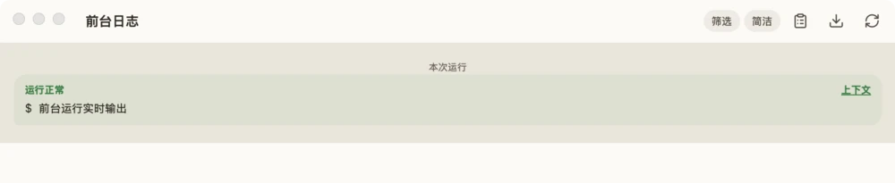

# 运行与日志

## 启动前台调试

1. 在左侧机器人列表选中项目，再点击右侧导航的 **运行**。
2. 看页首的项目名称和「依赖」状态。缺少依赖时，点 **控制** 查看依赖操作。
3. 在「前台运行」一行点 **启动前台**，按弹窗确认。需要登录时按[连接平台](/docs/alemonjsDocs/getting-started/connect-platform)配置。

找不到按钮时，可查看[运行页截图](/images/alemonx-desktop-guide/run-project.webp)。

## 打开前台日志

点击 **日志** 打开独立窗口，查看顶部的运行状态和下方输出。遇到启动失败时，先记录第一处错误及其前后日志，再检查依赖、端口或运行配置。需要结束调试时，回到运行页点 **停止运行**。

## 注册后台运行

需要持续运行时，在运行页找到「后台运行」。先确认前台调试已结束，再点击 **注册**，按弹窗配置 PM2 服务。注册后在同一区域查看进程状态和日志。

## 验证消息

开发阶段可在[桌面版本地测试](/docs/alemonx/use/runtime/local-test)验证指令。接入平台后，再到目标会话确认能收到回复。

如果工作台窗口本身打不开，参阅[启动排查](/docs/help/startup)。部署版工作台的服务状态和服务日志见[工作台命令行](/docs/alemonx/reference/cli)。
